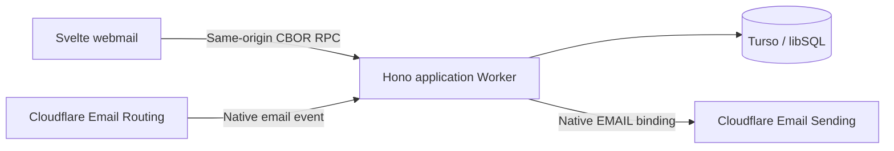

# Flaremail

**Your team’s mail, on your Cloudflare infrastructure.**

Flaremail is a self-hosted webmail application for personal and shared inboxes across multiple organizations. It combines a Svelte interface, a Cloudflare Workers backend, and Turso storage—with native Cloudflare email sending and receiving, rather than a mail server to maintain.

One installation can serve several organizations and domains. People sign in with one identity; organization membership and explicit mailbox grants determine which inboxes they can read and send from.

[Get started](#get-started) · [How it works](#how-it-works) · [Deploy](#deploy) · [Documentation](#documentation)

## What’s inside

- **An inbox built around conversations.** Search sender, subject, and message text; organize mail with stars, labels, archive, and trash; use bulk actions and undo for archive/trash.
- **Personal and shared mailboxes.** Grant active organization members access to read and send. Shared mailboxes share read, star, folder, and label state; drafts stay private to their author.
- **A full composer.** Rich text, attachments, Cc/Bcc, replies, reply-all, and forwarding, with saved drafts and conflict detection across tabs.
- **Organization administration.** Manage domains, mailboxes, memberships, roles, and password resets without treating administrative authority as automatic inbox access.
- **Keyboard-friendly webmail.** Responsive layouts, light and dark themes, shortcut help, and a reading pane on larger screens.
- **Deliberate mail handling.** Duplicate inbound deliveries are deduplicated. Send attempts use persistent reservations and idempotency keys; ambiguous provider outcomes are held for operator review.
- **Isolated message rendering.** Incoming HTML is sanitized on the server and in the browser, displayed in a sandboxed iframe, and kept from loading remote images until the reader allows them.

Flaremail is a webmail application, not an SMTP/IMAP server or a frontend for an existing mail provider. Real delivery requires your own Cloudflare and domain configuration. The default `SEND_MODE=simulate` saves Sent messages **without sending external email**.

## How it works



The application Worker serves the browser assets and API and receives inbound mail directly from Cloudflare Email Routing. Turso stores metadata, drafts, raw MIME, and attachments, with binary content split into 256 KiB chunks. No separate object store is required.

| Layer       | Technology                                             |
| ----------- | ------------------------------------------------------ |
| Interface   | Svelte 5, Vite, Tiptap, Bits UI                        |
| Application | Cloudflare Workers, Hono, TypeScript                   |
| Data        | Turso Cloud through the libSQL web client              |
| Contracts   | Shared Zod schemas, JSON-RPC 2.0 over CBOR             |
| Mail        | Cloudflare Email Sending and Email Routing, PostalMime |
| Tooling     | Bun workspaces, Oxlint, Oxfmt                          |

Local development runs the same application Worker and database client as production. Sending is simulated by configuration, not by replacing the application API with mocks.

## Get started

### 1. Prepare your environment

You’ll need [Bun 1.4.4](https://bun.com/docs/installation), Node.js 22.12 or later, and a dedicated **Turso Cloud development database** with an auth token. Local development still connects to Turso Cloud; it does not start an on-disk database. Cloudflare mail configuration is only needed when you’re ready for real delivery.

```sh
git clone https://github.com/tuuls-dev/flaremail.git
cd flaremail
bun install --frozen-lockfile
cp .dev.vars.example .dev.vars
```

Edit the root `.dev.vars`:

```dotenv
TURSO_DATABASE_URL=libsql://your-development-database.turso.io
TURSO_AUTH_TOKEN=your-development-database-token
```

This file is ignored by Git. If you already have `backend/.dev.vars`, move it to the repository root. Use a separate database and token for production.

### 2. Start the app

Run all commands from the repository root:

```sh
bun --env-file=.dev.vars run dev
```

This applies pending migrations, then starts the frontend and Worker together at **http://127.0.0.1:5173**.

The Vite/Workers runtime loads the root `.dev.vars` automatically. The explicit `--env-file` also gives the Bun migration script those credentials. Use the same flag for other development database commands unless you have already exported the intended variables.

### 3. Set up your first inbox

1. Open `/instance/setup` and create the instance administrator. Passwords must be 12–128 characters.
2. In administration, create an organization and add a domain, such as `example.com` for a simulated walkthrough.
3. Mark the domain ready for the walkthrough. For real mail, complete its DNS and Cloudflare setup first; the readiness flag does not verify those settings.
4. Create a mailbox, such as `hello@example.com`.
5. Open the mailbox’s **Access** dialog and grant yourself access. Creating a mailbox does not grant access automatically, even to an instance administrator.

With the local app running, use the Cloudflare email simulator to deliver five sample conversations to the Worker's `email()` handler.

```sh
SEED_MAILBOX=hello@example.com bun demo:seed
```

Replace the address with your configured mailbox. You can now read, search, compose, and send simulated messages without delivering mail externally.

## Configuration

| Setting              | Purpose                                                                                                               |
| -------------------- | --------------------------------------------------------------------------------------------------------------------- |
| `TURSO_DATABASE_URL` | Required Worker secret and database script environment variable. Use the libSQL URL of your database.                 |
| `TURSO_AUTH_TOKEN`   | Required Worker secret and database script environment variable. Use a database-scoped token.                         |
| `APP_ORIGIN`         | Optional exact origin for deployments that need an additional allowed origin. An empty value uses the request origin. |
| `SEND_MODE`          | `simulate` stores a Sent copy without external delivery; `live` calls the native email binding.                       |
| `EMAIL`              | Main Worker’s `send_email` binding, already declared in its Wrangler configuration.                                   |

Application defaults live in [`wrangler.jsonc`](wrangler.jsonc). Put development secrets in the root `.dev.vars` and supply production secrets through the deployment path you choose.

## Development

| Command                                       | What it does                                                                                         |
| --------------------------------------------- | ---------------------------------------------------------------------------------------------------- |
| `bun --env-file=.dev.vars run dev`            | Apply migrations and start the one-port development app.                                             |
| `bun dev:app`                                 | Start Vite/Workers without applying migrations.                                                      |
| `bun --env-file=.dev.vars run db:migrate`     | Apply pending, checksum-verified SQL migrations.                                                     |
| `bun lint`                                    | Run linting, formatting checks, import-boundary checks, TypeScript, and Svelte checks.               |
| `bun check`                                   | Run import-boundary and type checks.                                                                 |
| `bun test`                                    | Run backend and frontend-source tests.                                                               |
| `bun run test:runtime`                        | Run read-only protocol smoke checks against the running app.                                         |
| `bun run build`                               | Build browser assets and the application Worker.                                                     |
| `bun run types`                               | Regenerate Worker types after configuration changes.                                                 |
| `bun --env-file=.dev.vars run db:maintenance` | Remove expired sessions/login counters and old unreferenced uploads; mark interrupted sends unknown. |

Integration tests use isolated in-memory libSQL fixtures, not your configured cloud database. Browser verification scenarios are documented in the [end-to-end checklist](frontend/tests/e2e/README.md).

To **delete all application data** in a disposable development database and reapply migrations:

```sh
NODE_ENV=development bun db:reset
```

The reset command reads the root `.dev.vars` directly and requires a Turso Cloud database hostname containing a `dev` or `development` name segment. After resetting, complete `/instance/setup` again.

### Repository layout

```text
backend/
  contracts/       Shared schemas and RPC types
  docs/            Architecture and operations
  migrations/      Numbered SQL migrations
  scripts/         Development, database, and maintenance tools
  src/
    modules/       Identity, organizations, domains, mailboxes, mail, audit
    platform/      Database, security, email, and logging adapters
    transport/     RPC dispatch and inbound email handling
  tests/           Integration fixtures and runtime checks
frontend/
  docs/            Experience and interaction design
  src/
    app/           Router and layouts
    components/    Shared UI primitives
    features/      Mail, compose, authentication, administration, settings
    sdk/           Typed RPC and attachment client
  tests/e2e/       Browser verification checklist
```

## Deploy

Use **Use this template** on GitHub to start an independent repository, or **Fork** to keep a link to upstream for updates and contributions. The Cloudflare button can also create a repository in your GitHub account. [GitHub template and fork behavior](https://docs.github.com/en/repositories/creating-and-managing-repositories/creating-a-repository-from-a-template)

Before deploying, follow the [production database setup](backend/docs/operations.md#prepare-production) to create your Turso database, apply migrations, and create the first administrator. You’ll also need a Workers Paid account and a domain you control for live mail. [Cloudflare Email Service pricing](https://developers.cloudflare.com/email-service/platform/pricing/)

### Deploy with Wrangler

Clone your fork or template copy, then follow the [Wrangler deployment steps](backend/docs/operations.md#deploy-with-wrangler) to choose a Worker name and upload the Turso secrets with the first deploy.

### Deploy from the Cloudflare dashboard

[](https://deploy.workers.cloudflare.com/?url=https://github.com/tuuls-dev/flaremail)

The button creates a GitHub copy and deploys a Worker in your Cloudflare account. Have the initialized Turso database URL and token ready before you click it. See the [dashboard deployment steps](backend/docs/operations.md#deploy-from-the-cloudflare-dashboard) for Workers Builds settings and secret placement.

After either deployment, follow the [mail setup guide](backend/docs/operations.md#cloudflare-email) to configure sending, routing, and DNS for your domain and verify delivery to your first mailbox.

### Operational boundaries

- **Messages have a 5 MiB application limit.** Binary storage and transfers use chunking; this does not remove message-size limits.
- **Provider acceptance is not delivery.** Check Cloudflare delivery logs for bounces or later failures. Unknown send outcomes require deliberate operator reconciliation, not an automatic resend.
- **Maintenance is explicit.** Schedule `db:maintenance` against the intended database. It does not delete messages or automatically empty Trash.

## Documentation

- [Architecture and invariants](backend/docs/architecture.md) — authorization, module boundaries, RPC, storage, and send semantics.
- [Operations](backend/docs/operations.md) — production setup, email configuration, recovery, and maintenance.
- [Experience design](frontend/docs/experience.md) — layouts, workflows, accessibility, and interaction decisions.
- [Browser verification](frontend/tests/e2e/README.md) — repeatable end-to-end scenarios.

## Contributing and support

Maintained by [tuuls-dev](https://github.com/tuuls-dev). Use [GitHub issues](https://github.com/tuuls-dev/flaremail/issues) for bug reports and feature proposals, and pull requests for changes. Include reproduction steps and relevant logs without credentials or private mail content.

Follow [AGENTS.md](AGENTS.md): use verb-led function names and meaningful variable names, and run `bun lint` frequently. Keep frontend/backend imports behind `@flaremail/contracts`, and add new numbered migrations instead of modifying applied ones. Before submitting, run `bun lint`, `bun test`, and `bun run build`.

## License

Flaremail is licensed under the [GNU Affero General Public License v3.0 only](LICENSE). If you deploy a modified version, prominently offer its users the corresponding source for the version they use, at no charge. For example, link to the matching source release or archive from the sign-in page. [AGPL-3.0-only, section 13](https://spdx.org/licenses/AGPL-3.0-only.html#licenseText)
